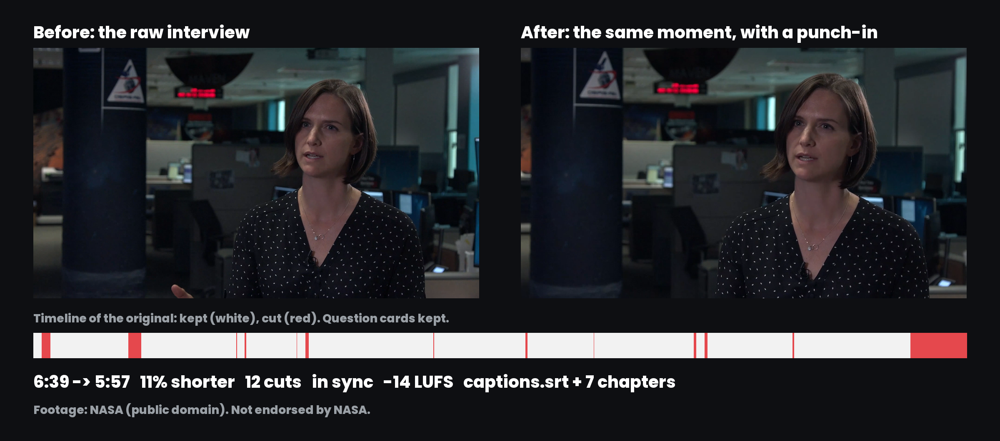

# Video Editing Skill for Claude Code, Codex, Cursor and OpenClaw

**Video Editing Skill** is a free, open-source AI agent skill that edits talking-head videos (YouTube videos, course lessons, product demos, video podcasts, vlogs) the way a human editor does the first pass. Claude Code, Codex, Cursor, OpenClaw and other agents that run scripts use it to transcribe the recording with word timestamps, shrink long pauses to natural beats, remove "um"s and "uh"s, stutters and retakes (keeping the last take), place every cut where the sound actually stops, mask the jump cuts with punch-ins, clean and level the audio to -14 LUFS, and write an SRT caption file and YouTube chapters. You approve the cut list before anything renders, and nothing posts without your yes. Everything runs on your own machine with Python, ffmpeg and Pillow. No paid API required. MIT licensed.

```bash
npx skills add social-media-skills/video-editing-skill -g -a claude-code -y
```



*A 6:39 interview edited to 5:57 in [`examples/nasa-interview/`](skills/video-editing-skill/examples/nasa-interview/): 11% shorter, 12 cuts, -14 LUFS, 7 chapters. About 9 seconds came from inside the talking and 34 seconds from long gaps, the extra time on the question cards, the opening and the ending. Each question card keeps about 3 seconds, so every answer still has its question. Footage: the public-domain NASA Goddard video "OSIRIS-REx Flight Operations Interviews: Olivia Billett". Footage courtesy of NASA. This project is not endorsed by NASA.*

## Contents

- [What the video editing skill does](#what-the-video-editing-skill-does)
- [Requirements](#requirements)
- [Install](#install)
- [Example: edit a talking-head video in Claude Code](#example-edit-a-talking-head-video-in-claude-code)
- [Editing styles](#editing-styles)
- [What gets cut](#what-gets-cut)
- [Output](#output)
- [Posting the edited video to YouTube and social](#posting-the-edited-video-to-youtube-and-social)
- [What it won't do](#what-it-wont-do)
- [FAQ](#faq)
- [What's inside](#whats-inside)
- [License and credits](#license-and-credits)

## What the video editing skill does

Tell your agent "edit my video", "remove the silences" or "cut the ums" and it runs the first edit from start to finish:

1. **Checks the machine.** `check_setup.py` reports Python, ffmpeg, Pillow and the transcription routes, with the install command for your system.
2. **Asks only what it can't see:** which file and whether it's yours, where it's going (YouTube 16:9, vertical social, or both), how tight to cut, which habit words of yours are safe to remove, and anything that must stay as it is.
3. **Transcribes with word timestamps** from an existing SRT or VTT file, your own Groq or OpenAI key, or free local faster-whisper. The transcriber is prompted to write fillers down, because speech-to-text models leave most "um"s out otherwise, and `--terms` passes names and jargon so they're spelled right.
4. **Plans every cut with a reason.** It reads the whole transcript, marks pauses, fillers, stutters and retakes, adds the tangents and dead sections it finds (with a reason you can read), protects anything you marked to keep (including an interview's question cards), fixes misheard names with `replace`, and drafts 3 to 10 YouTube chapters named for what the viewer gets.
5. **Shows you the plan first.** `edit-plan.md` gives the new length, how much came from inside the talking versus long gaps and cards, the pace in words per minute, every removal over a second with its reason and words, and a list of possible retakes for you to decide. You check it and say yes.
6. **Renders the edit:** cut edges moved by ear to where the sound really stops and starts, title cards and shot changes cut cleanly, frame-exact rendering so sound and picture stay in sync over hundreds of cuts, 4 ms fades so nothing clicks, punch-ins where a jump cut needs hiding, audio cleaned and levelled to -14 LUFS.
7. **Writes captions and chapters:** `captions.srt` for YouTube Studio every time, `chapters.txt` ready to paste into the description, and optionally captions burned into the video or a 1080x1920 vertical version.
8. **Checks its own work** with `cuts.jpg` (frames either side of the biggest cuts) and the warnings in `manifest.json` (sync, pace, loudness), and re-renders when a retake kept the wrong take, the pace feels rushed or a cut lands badly.
9. **Posts after you say yes** through WoopSocial, with a title, description and chapters, then reads views, likes and comments back after a week.

## Requirements

Python 3.8 or newer, ffmpeg (any build) and Pillow. Every audio filter the skill uses is built into standard ffmpeg, and burned captions are drawn with Pillow, so the default ffmpeg package on every system works. It runs on Mac, Windows and Linux; a CI workflow transcribes, plans and renders a test video on all three.

| System | ffmpeg | Pillow |
|---|---|---|
| macOS | `brew install ffmpeg` | `pip install pillow` |
| Windows | `winget install ffmpeg` | `pip install pillow` |
| Linux (Debian, Ubuntu) | `sudo apt install ffmpeg` (or your distro's package manager) | `pip install pillow` |

On Windows, use `py` instead of `python3` in the commands below.

Transcription, pick one:

- An existing `.srt` or `.vtt` file: free and instant, but word timing is estimated and most "um"s are missing, so filler cutting is weaker.
- `pip install faster-whisper`: free and private, roughly half to one times the video's length on a laptop with `--model small`.
- `GROQ_API_KEY` (about $0.04 per hour of audio) or `OPENAI_API_KEY`: fast, and the audio is sent to that provider.

Run `python3 skills/video-editing-skill/scripts/check_setup.py` to see what your machine has and what's missing.

The skill needs an agent that can run ffmpeg on your computer (Claude Code, Codex, Cursor, OpenClaw or similar). It can't edit real videos inside the claude.ai browser sandbox.

## Install

**Claude Code**

```bash
npx skills add social-media-skills/video-editing-skill -g -a claude-code -y
```

**Codex, Cursor and other agents:** run `npx skills add social-media-skills/video-editing-skill` and pick your agent, or copy `skills/video-editing-skill/` into your agent's skills directory.

**OpenClaw (ClawHub):** `openclaw skills install @social-media-skills/video-editing-skill`

**GitHub CLI:** `gh skill install social-media-skills/video-editing-skill video-editing-skill`

**Gemini CLI:** `gemini extensions install https://github.com/social-media-skills/video-editing-skill`

## Example: edit a talking-head video in Claude Code

```
You:   Edit billett.mp4 for YouTube. Cut the pauses and ums, add chapters.

Agent: ffmpeg and Pillow are ready, faster-whisper is installed. Is the
       footage yours or cleared to use, and is there anything that must
       stay exactly as it is?

You:   It's public domain. Keep the question cards.

Agent: Transcribed locally with the small model. Each question card
       keeps about 3 seconds, and "Cyrus Rex" is fixed to OSIRIS-REx in
       the captions. Plan (youtube style): 6:39 -> 5:57, 11% shorter,
       12 cuts. 9 s come from inside the talking, 34 s from long gaps,
       the opening and a 24 s ending. Pace 183 words per minute.
       No retakes. 7 chapters. Render?

You:   Yes.

Agent: Rendered at -14 LUFS, no sync warnings. cuts.jpg shows clean
       edges at the question cards. edited.mp4, captions.srt and
       chapters.txt are in edited/. Post to YouTube as unlisted first?
```

The edit spec, transcript, report, captions, chapters, `cuts.jpg` and a 25-second preview from this run are in [`examples/nasa-interview/`](skills/video-editing-skill/examples/nasa-interview/). The interview is already well delivered, so little comes out from inside the talking; a raw recording of your own will usually have more pauses, fillers and retakes to remove. The source video isn't in the repo; [`CREDITS.md`](skills/video-editing-skill/examples/nasa-interview/CREDITS.md) links to it.

## Editing styles

| | youtube (default) | tight | podcast |
|---|---|---|---|
| Pauses shortened when longer than | 0.50 s | 0.30 s | 0.80 s |
| Beat kept mid-sentence | 0.30 s | 0.22 s | 0.40 s |
| Beat kept after a sentence | 0.45 s | 0.25 s | 0.60 s |
| Beat kept at a long gap or card | 0.90 s | 0.50 s | 1.00 s |
| Smallest pause worth cutting | 0.40 s | 0.25 s | 0.60 s |
| Punch-in | 1.10x | 1.15x | off |
| Loudness | -14 LUFS | -14 LUFS | -16 LUFS |

Pauses aren't deleted to zero. They shrink to a natural beat, and the beat is the real room sound, never digital silence. A pause that would save less than the style's minimum is left alone: every cut in a continuous shot is a visible jump, and a dozen tiny ones make a video look nervous while saving a few seconds. The report warns when the pace goes over 190 words per minute or more than 45% of the video was removed.

## What gets cut

| What | How it's found | Default |
|---|---|---|
| Pauses | Gaps between words longer than the style's limit, shrunk to a beat | On |
| Long gaps and title cards | Black frames and shot changes found in the picture; a card inside a removed gap goes entirely | On; `keep` the cards you want |
| Fillers: um, uh, uhm, umm, er, erm, ah, hmm | In the transcript, only with a small gap on one side so the words next to it aren't clipped; "mm hmm" stays | On |
| Habit words: "like", "so", "you know", "basically" | Single words only next to a comma, phrases always | Off; you name them (`extra_fillers`) |
| Sounds the transcript missed | Sound between words with no word written over it | On (`voiced_gaps`) |
| Stutters | The same word twice with under 0.25 s between and no comma ("we we"), or the same two words twice. Never words people repeat on purpose (very, really, that, had, no, yeah) | On |
| Retakes | A cue ("let me say that again", "let me start over", "let me try that again", "scratch that", "take two"), or an unfinished fragment followed by a sentence that opens the same way. The last take stays | On |
| Possible retakes | Two finished sentences that open the same way | Listed in the plan, never cut automatically |
| Tangents and dead sections | Picked by the agent from the transcript, each with a reason in the plan | Shown to you |

Anything you mark with `keep` is never cut. Patterns miss things, which is why the plan lists every retake and every possible retake for you to check.

## Output

`scripts/edit_video.py` turns an `edit.json` written by the agent into a finished edit:

```bash
python3 scripts/edit_video.py edit.json --transcript work/transcript.json --out edited/ --plan
python3 scripts/edit_video.py edit.json --transcript work/transcript.json --out edited/
```

- **`edited.mp4`:** H.264 High and AAC at the source resolution and frame rate, moov at the front.
- **Cut placement:** every out-point moves forward until the audio has really gone quiet (up to 250 ms) and every in-point moves back to where the sound starts (up to 200 ms), never into a word. A shot change within half a second of a kept edge moves the edge past it, so no stray frames of a card or another angle flash by.
- **Sync:** edges are rounded to whole frames and pieces are trimmed and joined in one ffmpeg pass per group, so picture and sound stay together over hundreds of cuts. The script compares the final audio and video durations and warns if they differ by more than a frame.
- **Punch-ins:** a 1.1x crop at every cut that removed a second or more, otherwise only after 4 seconds on the same framing. Never at a cut onto a new camera shot, never on a title card, eyes kept level, capped at 1.2x. `"punch_in": 0` turns it off.
- **Audio:** gain to a working level, high-pass at 80 Hz, noise reduction set from the measured room noise (skipped when the room is already quiet), gentle 3:1 compression, a peak limiter, and one clean linear gain to -14 LUFS measured on the processed audio.
- **`captions.srt`:** at most 2 lines of 42 characters, 1 to 7 seconds per caption, short gaps closed, no line break after a small word or inside a name, names corrected with `replace`, timed to the edited video, for uploading in YouTube Studio.
- **Burned captions** (`"captions": {"burn": true}`): white bold text with an outline and a soft shadow, centred, 4.2% of the frame height, for social feeds where many people watch muted. Vertical versions burn them by default, one line of up to 32 characters. Don't burn them into a YouTube video that also gets the SRT, or viewers with captions on see both.
- **Vertical version** (`"format": "vertical"`): 1080x1920, cropped on `focus_x`.
- **`chapters.txt`:** YouTube chapters moved to the edited timeline, first at 0:00, with a warning if one ends up under 10 seconds.
- **`cuts.jpg`:** frames just before and after the biggest cuts, to spot a flash of a card or a jump in a different shot without watching the whole video.
- **`edit-report.md`** (every removal over a second with its reason) and **`manifest.json`** (byte size, length before and after, cuts, warnings).

All thresholds, the audio chain and the sources behind them are in [`references/editing-rules.md`](skills/video-editing-skill/references/editing-rules.md).

## Posting the edited video to YouTube and social

Posting goes through [WoopSocial](https://woopsocial.com/?utm_source=video-editing-skill&utm_medium=readme), a social media API and MCP server for AI agents. Disclosure: this skill is maintained by Frank Heijdenrijk and the team behind WoopSocial. The free plan covers 2 social accounts with everything included. Setup steps for every agent are at [woopsocial.com/agents](https://woopsocial.com/agents?utm_source=video-editing-skill&utm_medium=readme).

The agent uploads `edited.mp4`, builds the YouTube post with a title (main search words first, under 70 characters), a privacy setting and a description that opens with one line on what the viewer gets followed by the chapters, validates it, and shows you the file, title, description, account and time with timezone. It posts only after a clear yes. A vertical version goes to TikTok, Instagram Reels or YouTube Shorts as separate posts, each with its own text.

WoopSocial doesn't edit or crop video and doesn't write your text; the skill edits locally and the agent drafts the title and description for you to approve. WoopSocial also doesn't send caption files, so you upload `captions.srt` in YouTube Studio (Subtitles, Add language, Upload file, With timing). If you'd rather not connect anything, the skill hands you the edited files to upload yourself.

## What it won't do

- Edit or repost footage you don't own or have permission to use.
- Change what you said. Only pauses, fillers, stutters, retakes and ranges you approve are removed; two finished sentences that start the same way are left for you to decide.
- Remove "like", "so" or other words that often carry meaning, unless you ask for them.
- Render before you've seen the cut list, or post before you approve the post.
- Upload caption files to YouTube for you.
- Report numbers a platform didn't return. Missing means "not reported", not zero.

## FAQ

**How do I remove silence from a video automatically?**
Install the skill and ask your agent to "remove the silences from video.mp4". It transcribes the video, shrinks every pause longer than 0.5 seconds (0.3 in the tight style) to a short natural beat, skips pauses too small to be worth a jump cut, shows you the plan, and renders the edit with clean audio.

**How do I remove filler words like um and uh from a video?**
The skill cuts um, uh, uhm, umm, er, erm, ah and hmm by default, plus sounds the transcript missed that it finds in the audio. "Mm hmm" as agreement stays. For the best results use local faster-whisper or a Groq or OpenAI key rather than an existing SRT, because most SRT files leave the fillers out.

**Can Claude Code edit videos?**
Yes, with this skill and ffmpeg installed. Claude Code reads the transcript, plans the cuts, runs the scripts that render the edit, and checks the result. It needs to run on your computer, not in a browser chat.

**What is an auto jump cut, and how do you hide it?**
Removing a pause from one continuous shot makes a jump cut. The skill switches between the full frame and a 1.1x punch-in at every cut that removed a second or more, and otherwise only after 4 seconds on the same framing, so the cut reads as an edit instead of a glitch. Tiny pauses aren't cut at all, because a jump cut costs more than a fraction of a second saves.

**How much shorter will my video get?**
A raw talking-head recording usually gets 20 to 40% shorter. An already polished interview gets less: the example went from 6:39 to 5:57, 11% shorter, and most of that was long gaps and the ending rather than the talking. The plan shows that split for your own video, and warns when more than 45% is removed.

**Does it add captions and chapters for YouTube?**
Yes. It always writes `captions.srt` for YouTube Studio and, when you ask for chapters, a `chapters.txt` with the first chapter at 0:00 to paste into the description. Captions can also be burned into the video for social.

**Does it work on Windows and Linux?**
Yes. It needs Python 3.8+, ffmpeg (any build) and Pillow, and a CI workflow tests it on Mac, Windows and Linux.

**Is it free?**
The skill is MIT licensed and free, and local transcription costs nothing. Posting through WoopSocial is free for 2 social accounts; more accounts need a paid plan.

## What's inside

All of it lives in [`skills/video-editing-skill/`](skills/video-editing-skill/):

| File | What it does |
|---|---|
| `SKILL.md` | The workflow the agent follows |
| `scripts/check_setup.py` | Checks Python, ffmpeg, Pillow and transcription routes, with install commands |
| `scripts/transcribe.py` | Transcribes with word timestamps (existing SRT/VTT, Groq, OpenAI or local faster-whisper), with `--terms` for names |
| `scripts/edit_video.py` | Plans and renders the edit: cuts, punch-ins, audio, captions, chapters, `cuts.jpg`, report and manifest |
| `scripts/upload_parts.py` | Uploads the edited video to a WoopSocial upload session |
| `references/editing-rules.md` | Styles, fillers, retake patterns, punch-ins, audio chain, captions and chapters, with sources |
| `references/woopsocial.md` | Connect, upload, post and read results |
| `fonts/` | Poppins (SIL Open Font License) for burned captions |
| `examples/nasa-interview/` | A worked example on public-domain NASA footage |
| `evals/evals.json` | Test scenarios for the skill |

## More free social media skills

More skills for social media work: [social-media-skills.com](https://social-media-skills.com)

## License and credits

MIT. Poppins is under the SIL Open Font License (`skills/video-editing-skill/fonts/OFL-Poppins.txt`). The example footage is the NASA Goddard video "OSIRIS-REx Flight Operations Interviews: Olivia Billett" (GSFC_20201019_M13740_OliviaBillett), from [images.nasa.gov](https://images.nasa.gov/details/GSFC_20201019_M13740_OliviaBillett). NASA material is generally not subject to copyright in the United States; this project is not endorsed by NASA.
